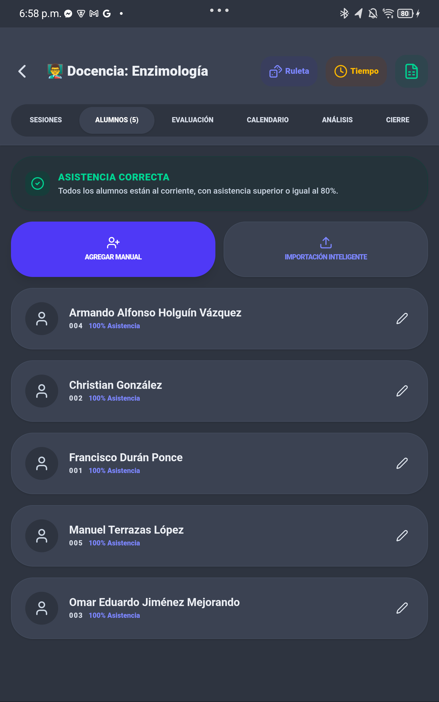
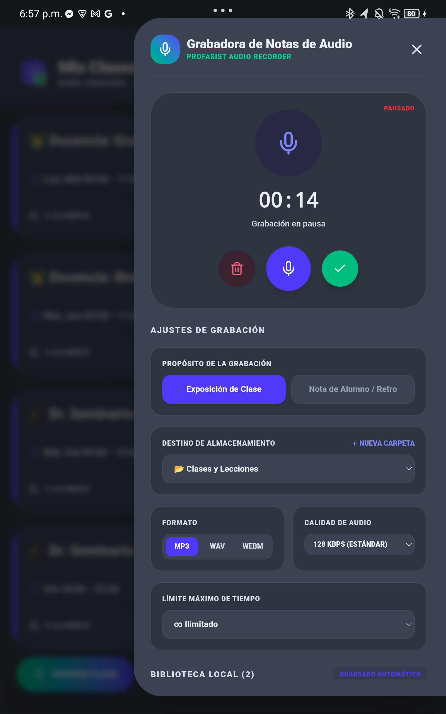
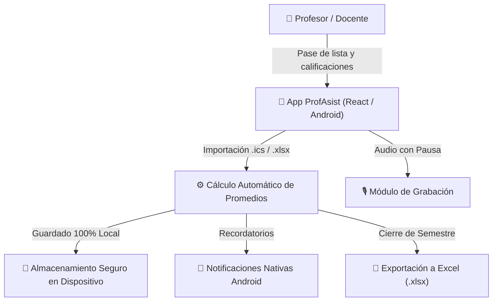

# ProfAsist

[](LICENSE)
[](CHANGELOG.md)
[](https://www.typescriptlang.org/)
[](https://capacitorjs.com/)
[](https://doi.org/10.5281/zenodo.21501969)

> **ProfAsist** es un asistente docente offline diseñado para facilitar el trabajo diario en el aula. Te permite tomar asistencia en segundos, calificar a tus alumnos con ponderación automática y exportar tus actas a Excel sin depender de internet ni pagar suscripciones.

---

## 📸 Capturas de Pantalla

| Evaluación Ponderada | Pase de Lista y Alertas |
|---|---|
|  |  |
| *Ponderación automática al 100% y captura rápida de calificaciones.* | *Pase de lista con 1 tap y detección automática de alumnos en riesgo.* |

| Grabadora con Pausa en Vivo | Cierre de Curso y Actas |
|---|---|
|  |  |
| *Grabación de notas de audio con pausa y reanudación en vivo.* | *Concentrado final del semestre listo para exportar a Excel.* |

---

## 💡 ¿Por qué creé ProfAsist?

Llevar la lista y las calificaciones en cuadernos impresos o en hojas de Excel desde el celular suele ser incómodo, lento y propenso a errores. 

Diseñé **ProfAsist** para resolver ese problema cotidiano: una herramienta ágil, limpia y **100% offline** (los datos se quedan guardados de forma segura en tu propio teléfono o tablet, sin depender de redes Wi-Fi ni servidores externos).

---

## 🚀 Lo que puedes hacer con la app

### 📊 1. Evaluación con Ponderación Automática
- Configuras tus criterios de evaluación (*Tareas, Exámenes, Prácticas, Bitácora*) y la app **equilibra automáticamente los porcentajes al 100%**.
- Agregas las actividades que necesites en cada parcial y ProfAsist calcula los promedios al instante, sin necesidad de escribir fórmulas.
- Al terminar el curso, exportas el concentrado en formato **Excel (`.xlsx`)** o listo para imprimir.

### 📅 2. Carga Rápida de Horarios con `.ics`
- Puedes importar tu horario de clases directamente subiendo un archivo iCalendar (`.ics`) descargado de Google Calendar o de tu portal académico, o bien crearlo manualmente.

### 👥 3. Importación Flexible de Alumnos
- Sube tus listas de clase desde archivos **Excel (`.xlsx`)**, archivos de texto o agrégalos uno a uno.
- Puedes incluir matrículas y guardar el número de teléfono con botón directo para enviar mensajes por **WhatsApp**.

### 📋 4. Pase de Lista Rápido y Alertas de Riesgo
- Pasa lista en segundos con toques sencillos.
- La app calcula el porcentaje de asistencia acumulado de cada alumno y te avisa cuando alguien está por perder derecho a examen por faltas.

### 🎙️ 5. Grabadora de Audio con Pausa en Vivo
- Graba explicaciones de clase, notas sobre un alumno o acuerdos del día.
- Incluye la función de **Pausar (`⏸`) y Reanudar (`🎙️`)** en vivo, ideal por si interrumpen la clase o necesitas hacer una pausa sin cortar el archivo de audio.

### 🔔 6. Recordatorios y Notificaciones Nativas
- Recibe recordatorios en la barra de estado de tu teléfono Android para no olvidar pasar lista antes de cada clase.

### 📥 7. Auditoría de Entregas Multicanal
- Registra entregas recibidas por **Teams, Outlook, WhatsApp, USB o presencial**, con evidencia, fecha y nota.
- Importa listados **CSV/JSON** y detecta duplicados antes de aplicar calificaciones.
- Calcula cobertura por actividad y muestra los huecos de entrega para que ninguna evidencia se pierda.

### 📑 8. Actas Institucionales de 4 Pestañas
- Genera un libro `.xlsx` por materia con **Resumen Semestral**, **Parcial 1**, **Parcial 2** y **Parcial 3**.
- Fórmulas nativas, paneles congelados y recálculo al abrir (`fullCalcOnLoad`).
- Semáforo de acreditación verde/rojo y datos institucionales parametrizables (Universidad, Instituto, Laboratorio, Semestre, Profesor).

### 🤖 9. Modo Agente y Sincronización ADB
- Exporta/restaura snapshots locales y conserva hasta 20 copias automáticas en IndexedDB.
- El CLI `tools/adb_bridge/` permite `doctor`, `pull`, `diff`, `push` y `audit` con merge idempotente.
- La APK **agent** expone el WebView DevTools solo para sincronización local; la release normal no.

---

## 🛠️ Tecnologías Utilizadas

- **Interfaz**: React 19, TypeScript, Vite.
- **Runtime Móvil**: Capacitor 8 (Android).
- **Procesamiento de Archivos**: ExcelJS para actas institucionales, SheetJS para importación e `ical.js` para calendarios `.ics`.
- **Audio y Notificaciones**: Web Audio API y Capacitor Local Notifications.
- **Almacenamiento**: LocalStorage / IndexedDB (100% Local en el dispositivo).
- **Sincronización**: ADB + Chrome DevTools Protocol (Playwright).



---

## 💻 Compilación e Instalación

Si deseas compilar la aplicación tú mismo desde el código fuente:

```bash
# 1. Clonar el repositorio e instalar dependencias
git clone https://github.com/carlosmontejo99/profasist.git
cd profasist
npm install

# 2. Servidor de prueba local
npm run dev

# 3. Compilar bundle web y sincronizar con Android
npm run build
npx cap sync android

# 4. Generar APK de Android
cd android
./gradlew assembleDebug
```

El archivo `.apk` compilado se genera en:
`android/app/build/outputs/apk/debug/app-debug.apk`

---

## 📄 Licencia y Cita Académica

Este proyecto es de código abierto y se distribuye bajo la licencia **GNU General Public License v3.0** (ver archivo [LICENSE](LICENSE)).

Si utilizas o referencias este software en un trabajo académico o investigación:

```bibtex
@software{Montejo_ProfAsist_2026,
  author = {Montejo Dávila, Carlos},
  title = {ProfAsist: Asistente docente offline local-first para asistencia, evaluación y seguimiento académico},
  year = {2026},
  doi = {10.5281/zenodo.21501969},
  url = {https://doi.org/10.5281/zenodo.21501969}
}
```

---
*Desarrollado por Carlos Montejo Dávila como una solución práctica y de código abierto para apoyar la labor docente diaria.*
