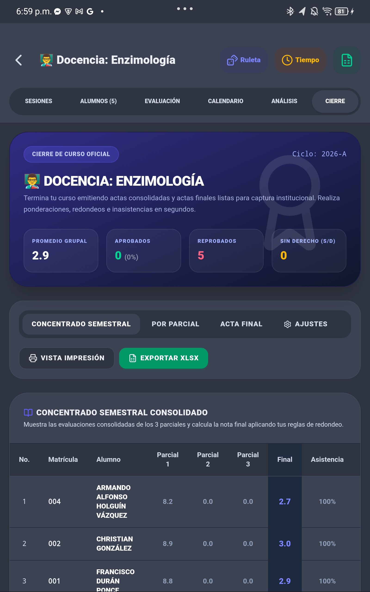
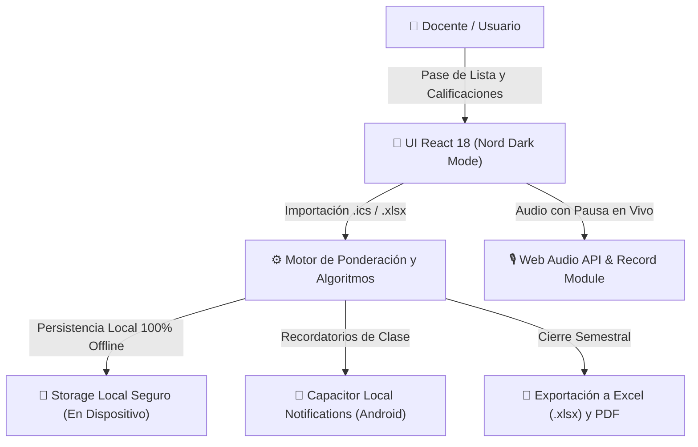

# ProfAsist

[](LICENSE)
[](CHANGELOG.md)
[](https://www.typescriptlang.org/)
[](https://capacitorjs.com/)
[](https://doi.org/10.5281/zenodo.21501969)

> **ProfAsist** es una plataforma orientada a la gestión docente local-first (100% offline). Simplifica el pase de lista, la evaluación académica mediante criterios auto-equilibrados y el seguimiento continuo de grupos, sin requerir hojas de cálculo manuales ni conexión a internet.

---

## Demostración Visual

| Sistema de Evaluación Ponderada | Control de Asistencia y Alertas de Riesgo |
|---|---|
|  |  |
| *Cálculo automático de ponderaciones al 100% y captura rápida de calificaciones.* | *Pase de lista en vivo y monitoreo automático de umbrales de inasistencia.* |

| Grabadora Inteligente con Pausa en Vivo | Analítica Académica y Cierre de Curso |
|---|---|
|  |  |
| *Módulo de grabación pedagógica con estados de pausa y reanudación en vivo.* | *Concentrado semestral consolidado con exportación directa a Excel.* |

---

## Fundamentos del Sistema

La administración académica en el aula frecuentemente depende de herramientas genéricas (cuadernos impresos o plantillas complejas de hoja de cálculo) que introducen fricción operativa y riesgo de error humano. **ProfAsist** aborda esta problemática mediante una arquitectura centrada en la privacidad, simplicidad de uso y automatización matemática.

- **Privacidad Local-First**: Todos los datos (alumnos, asistencias, notas y audios) se almacenan localmente en el dispositivo. No requiere servicios en la nube obligatorios ni suscripciones.
- **Operación Offline**: Diseñada para funcionar en aulas de clase sin cobertura de red o conexión a internet.

---

## Módulos y Funcionalidades

### 1. Evaluación Académica Auto-Equilibrada
- **Algoritmo de Ponderación Automática**: Ajusta dinámicamente los porcentajes de cada categoría de evaluación (ej. *Tareas 20%, Exámenes 40%, Prácticas 20%, Bitácora 20%*) asegurando una suma exacta del 100%.
- **Cálculo de Promedios por Parcial**: Permite añadir múltiples actividades dentro de cada criterio, calculando los promedios parciales y finales en tiempo real.
- **Exportación Institucional**: Genera archivos consolidados en formato **Excel (`.xlsx`)** y documentos preparados para impresión o almacenamiento digital.

### 2. Automatización de Horarios mediante `.ics`
- **Sincronización de Horarios**: Permite cargar estructuras de horarios grupales importando archivos estándar iCalendar (`.ics`) procedentes de Google Calendar, Outlook o plataformas institucionales.
- **Configuración Manual**: Proporciona interfaces intuitivas para el alta y edición manual de materias.

### 3. Gestión e Importación de Alumnos
- **Alta Masiva de Roster**: Importación directa de listas de alumnos desde archivos **Excel (`.xlsx`)** y listas de texto estructurado.
- **Datos de Contacto Directo**: Almacenamiento de matrícula, nombre completo y enlace directo a comunicación por **WhatsApp**.

### 4. Control de Asistencia y Alertas Preventivas
- **Pase de Lista en Un Solo Tap**: Registro eficiente de asistencia diaria.
- **Detección Temprana de Riesgo**: Algoritmo de monitoreo que calcula el porcentaje acumulado de asistencia y notifica al docente cuando un estudiante está por perder derecho a evaluación.

### 5. Módulo de Audio Pedagógico con Pausa en Vivo
- **Grabación Continua Adaptativa**: Permite registrar notas de voz, explicaciones de clase y acuerdos académicos.
- **Control de Estado (`Pausar` / `Reanudar`)**: Habilidad para pausar la captura de audio en interrupciones del aula sin fragmentar la grabación ni perder el cronómetro acumulado.
- **Organizador Local**: Clasificación sistemática de audios por grupo, fecha y lección.

### 6. Notificaciones y Recordatorios Nativos
- **Alertas de Sistema**: Recordatorios configurables en la barra de estado de Android para el inicio de sesiones de clase.
- **Retroalimentación Háptica y Sonora**: Señales táctiles y sonoras para una interacción ágil durante la docencia.

### 7. Analítica Académica e Informes
- Visualización gráfica del desempeño y tasa de asistencia grupal e individual.
- Identificación de tendencias de inasistencia según el día de la semana.
- Resumen consolidado para cierre de semestre.

---

## Arquitectura Técnica

El sistema está desarrollado con una pila tecnológica moderna enfocada en rendimiento nativo e independencia de red:

- **Frontend Core**: React 18, TypeScript, Vite.
- **Contenedor Móvil**: Capacitor 7 (Android Native Bridge).
- **Servicios Nativos**: Capacitor Local Notifications API.
- **Procesamiento de Datos**: SheetJS (`xlsx`) para manipulación de hojas de cálculo e `ical.js` para parseo de calendarios `.ics`.
- **Procesamiento de Audio**: Web Audio API con integración háptica nativa.
- **Persistencia**: Storage local optimizado (LocalStorage / IndexedDB).



---

## Guía de Compilación e Instalación

### Requisitos Previos
- Node.js (versión 20 o superior) y `npm`.
- Android Studio con SDK de Android configurado (JDK 17+).

### Pasos de Compilación

```bash
# 1. Clonar el repositorio e instalar dependencias
git clone https://github.com/carlosmontejo99/profasist.git
cd profasist
npm install

# 2. Iniciar el servidor de desarrollo local
npm run dev

# 3. Compilar el paquete web y sincronizar con Android
npm run build
npx cap sync android

# 4. Generar el paquete ejecutable (APK)
cd android
./gradlew assembleDebug
```

El archivo APK resultante se ubica en:
`android/app/build/outputs/apk/debug/app-debug.apk`

---

## Licencia y Citación Académica

Este proyecto se distribuye bajo la licencia **GNU General Public License v3.0**. Para más información, consulte el archivo [LICENSE](LICENSE).

Para citar formalmente este software en publicaciones científicas o académicas:

```bibtex
@software{Montejo_ProfAsist_2026,
  author = {Montejo Dávila, Carlos},
  title = {ProfAsist: Asistente docente offline local-first para asistencia, evaluación y seguimiento académico},
  year = {2026},
  doi = {10.5281/zenodo.21501969},
  url = {https://doi.org/10.5281/zenodo.21501969}
}
```

---
*ProfAsist es un proyecto de código abierto enfocado en la optimización operativa de la gestión docente y la privacidad de datos en el entorno educativo.*
