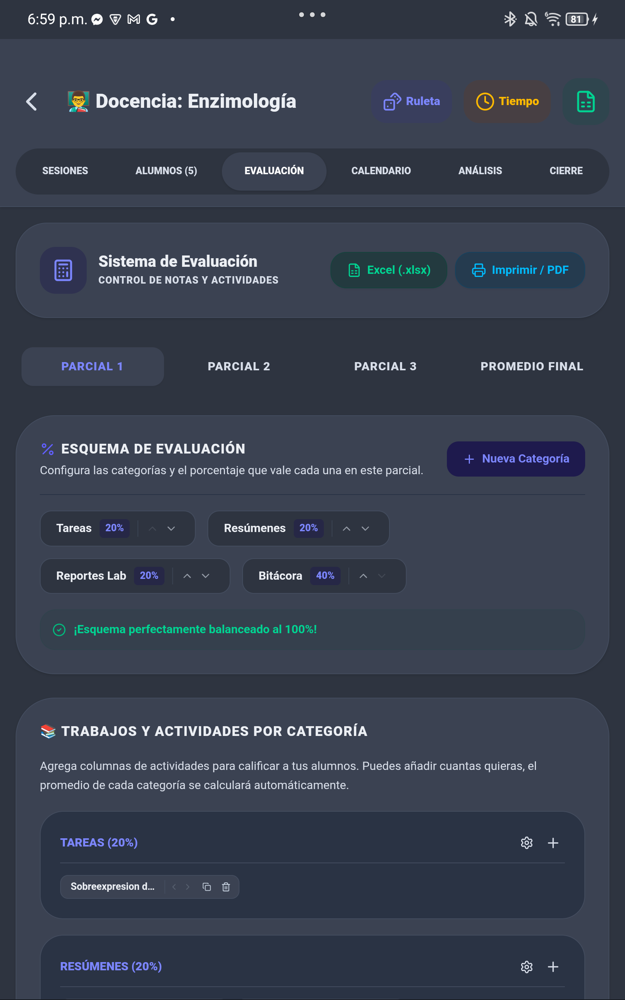

# 🎓 ProfAsist - Asistente Docente Inteligente

[](LICENSE)
[](CHANGELOG.md)
[](https://www.typescriptlang.org/)
[](https://capacitorjs.com/)
[](https://zenodo.org/account/settings/github/)

> **La herramienta offline local-first diseñada para el docente moderno: pasa lista en segundos, califica sin fricción mental y genera actas de evaluación auto-equilibradas sin depender de hojas de cálculo pesadas.**

---

## 📸 Demostración Visual (Tablet & Smartphone)

| 📊 Sistema de Evaluación Ponderada | 📋 Pase de Lista & Alerta de Riesgo |
|---|---|
|  |  |
| *Ponderación de criterios auto-equilibrada al 100% y captura rápida de notas.* | *Registro de asistencia y detección en tiempo real de alumnos en riesgo.* |

| 🎙️ Grabadora Inteligente (Pausa/Reanudar) | 📈 Analítica Académica & Cierre de Actas |
|---|---|
|  |  |
| *Grabación de notas pedagógicas con pausa y reanudación en vivo.* | *Concentrado semestral consolidado listo para publicar o exportar a Excel.* |

---

## 🌟 ¿Por qué ProfAsist?

Llevar el control de asistencia y calificaciones en cuadernos de papel o en complejas plantillas de Excel en el celular suele ser lento, incómodo y propenso a errores. 

**ProfAsist** elimina por completo la **fricción mental** del docente con una interfaz fluida, libre de distracciones y **100% offline** (los datos permanecen en tu dispositivo de forma segura).

---

## ✨ Características Principales

### ⚖️ 1. Evaluación Inteligente con Ponderación Auto-Equilibrada
- **Ponderación Automática**: Asigna porcentajes a tus categorías de evaluación (ej. *Tareas 20%, Exámenes 40%, Prácticas 20%, Bitácora 20%*) y la aplicación **auto-equilibra los valores al 100%**.
- **Cálculo de Promedios sin Fórmulas**: Agrega las actividades que quieras en cada parcial; ProfAsist calcula promedios ponderados en tiempo real.
- **Exportación en 1 Clic**: Genera concentrados finales y exporta actas institucionales en formato **Excel (`.xlsx`)** o listas para imprimir/PDF.

### 📅 2. Automatización de Horarios mediante `.ics`
- **Carga de Horarios en Segundos**: Importa los calendarios de tus materias directamente desde archivos iCalendar (`.ics`) generados por Google Calendar, Outlook o el portal institucional.
- **Creación Manual Flexible**: Si prefieres, crea materias y horarios manualmente de forma rápida.

### 👥 3. Importación Flexible de Listas de Alumnos
- Importa tus listas de clase desde archivos **Excel (`.xlsx`)**, archivos de texto plano o agrégalos manualmente.
- Asigna matrículas, nombres completos y teléfonos de contacto directo por **WhatsApp**.

### 📋 4. Pase de Lista Ultra Rápido y Alertas Preventivas
- Toma asistencia diaria en cuestión de segundos con un solo toque.
- **Alertas de Inasistencia**: Detección automática en tiempo real de alumnos que están cerca o sobrepasan el límite de inasistencias permitidas para presentar examen.

### 🎙️ 5. Grabadora Pedagógica Inteligente de Audio
- Registra explicaciones, acuerdos de clase o notas de alumnos.
- **Pausa y Reanudación en Vivo (`⏸` / `🎙️`)**: Pausa la grabación cuando interrumpan la clase y reanúdala sin fragmentar el archivo ni perder el conteo de tiempo.
- **Biblioteca Local**: Organiza y clasifica audios por materia, lección o alumno.

### 🔔 6. Notificaciones Nativas y Recordatorios
- Recordatorios automáticos en la barra de estado de Android para el pase de lista antes o al inicio de cada clase.
- Efectos de sonido y retroalimentación háptica inteligentes.

### 📊 7. Analítica Académica Inteligente
- Gráficas visuales de porcentaje de asistencia grupal e individual.
- Estadísticas descriptivas de inasistencias por días de la semana (ej. *descubrir inasistencias recurrentes los viernes*).
- Tableros de rendimiento grupales y predicción de riesgo académico.

---

## 📱 Compatibilidad y Diseño Adaptativo

ProfAsist cuenta con una arquitectura de interfaz responsiva con el tema **Ártico Nord (Dark Mode)**, adaptándose de forma nativa a:
- 📱 **Smartphones Android** (1080 × 2400 o similar)
- 📲 **Tablets Android** (Pantallas grandes de alta densidad como 1600 × 2560)

---

## 🛠️ Tecnologías y Arquitectura

- **Core**: React 18, TypeScript, Vite.
- **Mobile Runtime**: Capacitor 7 (Android Native Container).
- **Notificaciones**: Capacitor Local Notifications.
- **Procesamiento de Archivos**: SheetJS (`xlsx`) para Excel e `ical.js` para `.ics`.
- **Audio**: Web Audio API / MediaRecorder API con integración háptica nativa.
- **Almacenamiento**: LocalStorage / IndexedDB (Local-First, Privacy Preserving).

---

## 🚀 Desarrollo y Compilación Local

### Requisitos Prerequisito
- Node.js (v20 o superior) y `npm`.
- Android Studio y Android SDK (JDK 17+).

```bash
# 1. Clonar el repositorio e instalar dependencias
git clone https://github.com/carlosmontejo99/profasist.git
cd profasist
npm install

# 2. Ejecutar servidor de desarrollo local
npm run dev

# 3. Compilar bundle web y sincronizar con Android
npm run build
npx cap sync android

# 4. Compilar APK de Android
cd android
./gradlew assembleDebug
```

La APK compilada se genera en:
`android/app/build/outputs/apk/debug/app-debug.apk`

---

## 📄 Licencia y Citación Académica

Este proyecto se distribuye bajo la licencia **GNU General Public License v3.0**. Consulta el archivo [LICENSE](LICENSE) para más detalles.

Para citas académicas o científicas del software:
```bibtex
@software{Montejo_ProfAsist_2026,
  author = {Montejo Dávila, Carlos},
  title = {ProfAsist: Asistente docente offline local-first para asistencia, evaluación y seguimiento académico},
  year = {2026},
  url = {https://github.com/carlosmontejo99/profasist}
}
```

---
*Desarrollado con ❤️ para facilitar la labor docente diaria.*
